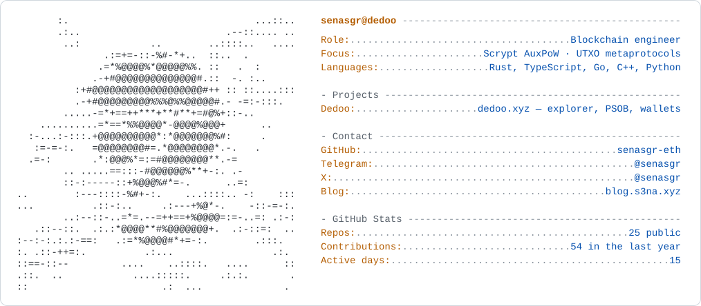

<picture>
  <source media="(prefers-color-scheme: dark)" srcset="card_dark.svg">
  
</picture>

<picture>
  <source media="(prefers-color-scheme: dark)" srcset="board_dark.svg">
  
</picture>

### hey, I'm Senasgr

**Block by block.** I build **[Dedoo](https://dedoo.xyz)** — an explorer, PSOB and wallet stack for Scrypt AuxPoW chains, plus select UTXO networks.

- 🔭 **[Explorer](https://dedoo.xyz/explorer/junkcoin)** — blocks, mempool, transactions and addresses across every indexed network
- 🧾 **[PSOB Explorer](https://dedoo.xyz/research)** — sibling-block proofs and live sibling groups from the PSob indexer
- 👛 **[Wallet](https://dedoo.xyz/wallet)** — non-custodial Android and Chrome wallet with multi-sig, PSBT and Nostr
- 🧱 **[utxo-vm](https://github.com/dedooxyz/utxo-vm)** — a clean-room smart-object protocol for any UTXO blockchain

The whole stack is open source under **[dedooxyz](https://github.com/dedooxyz)** — from [`psob-indexer`](https://github.com/dedooxyz/psob-indexer) and [`dedoo-electrs-newchain`](https://github.com/dedooxyz/dedoo-electrs-newchain) to [`dedoo-wallet-sdk`](https://github.com/dedooxyz/dedoo-wallet-sdk) and [`zk-scrypt-lightclient`](https://github.com/dedooxyz/zk-scrypt-lightclient).

**elsewhere** · [dedoo.xyz](https://dedoo.xyz) · [@senasgr](https://x.com/senasgr) · [blog](https://blog.s3na.xyz)
